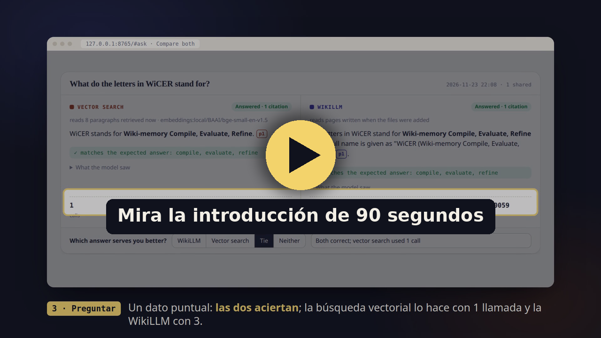

# ragwiki

**¿Búsqueda vectorial, WikiLLM u otro tipo de RAG? Constrúyelos con tus propios documentos y
deja que tus preguntas decidan.** ragwiki convierte archivos PDF, Word, PowerPoint y de texto
en un índice de búsqueda vectorial (RAG), en una wiki que un modelo de lenguaje escribe y
mantiene enlazada (WikiLLM), o en ambas, y responde con el mismo modelo en los dos casos.
También compara tipos de RAG sobre tus archivos (por palabras, vectorial, híbrida, con
reordenador y con más contexto) sin llamar a un modelo. Cada afirmación enlaza al párrafo del
que salió, en español o en inglés.

| Quieres saber | ragwiki te da |
|---|---|
| ¿Vale la pena el costo de una WikiLLM para mis archivos? | Las dos respuestas lado a lado, con tokens, tiempo, costo y una recomendación |
| ¿Qué búsqueda encuentra mejor mis respuestas? | Una clasificación gratuita de cinco tipos de RAG con tus propias preguntas |
| ¿De dónde salió esta afirmación? | Un clic en la cita abre el párrafo de origen |

[Read in English](README.md)

## Míralo en 90 segundos

[](https://jdramirezzu.github.io/ragwiki/video/#es)

El video sigue una corrida real con cinco artículos de arXiv sobre wikis mantenidas por LLM,
respondidos por `deepseek-flash`:

1. **Archivos.** Cinco PDF se convierten en 184 párrafos citables, gratis.
2. **Construir.** El índice vectorial se construye en el computador; la WikiLLM escribe 24 páginas
   enlazadas por 0,11 USD, con el costo a la vista antes de gastar.
3. **Preguntar.** En un dato puntual las dos aciertan y la búsqueda vectorial gasta menos. En una
   pregunta que une varios artículos solo la WikiLLM los sintetiza, a unas 11 veces el costo.
4. **Resultados.** Una recomendación para ese corpus, con costos, tiempos y los veredictos de la
   persona.

[Míralo en inglés](https://jdramirezzu.github.io/ragwiki/video/#en). El video se genera con código en
[`docs/video`](docs/video/README.md), así que se puede actualizar cuando cambie el laboratorio.

> Estado: desarrollo inicial, construido de forma abierta a partir de un proyecto de
> investigación de maestría. La [hoja de ruta](#hoja-de-ruta) indica qué funciona hoy.

## Inicio rápido: el laboratorio

```bash
git clone https://github.com/jdramirezzu/ragwiki.git && cd ragwiki
uv sync --extra lab
uv run ragwiki lab ~/mi-laboratorio
```

La página se abre en tu navegador en `http://127.0.0.1:8765`. Corre solo en tu computador;
lo único que sale de él son las llamadas al modelo. Configura el modelo en la página (la
clave se guarda en memoria, nunca en disco) o con las variables `RAGWIKI_*` de más abajo.

1. **Archivos.** Arrastra PDF, archivos de Word o PowerPoint, o texto plano (`.txt`, `.md`).
   Agregarlos es gratis: el texto se extrae en tu computador en párrafos citables.
2. **Construir.** Construye el índice de **búsqueda vectorial** (embeddings en tu computador,
   gratis; o los de tu proveedor), la **WikiLLM** (unas dos llamadas al modelo por archivo,
   con el costo a la vista antes de gastar) o las dos. La página explica en qué se
   diferencian y cuándo conviene cada una.
3. **Preguntar.** Pregunta con la que construiste, o con las dos: el mismo modelo responde
   dos veces y las respuestas aparecen lado a lado con sus citas, tokens, tiempo y costo.
   Al hacer clic en una cita, el párrafo de la fuente aparece al lado. Si quieres, agrega la
   respuesta esperada como términos clave (`¿Qué produce ATP? | ATP, mitocondria`), o `none`
   cuando tus archivos no la responden.
4. **Resultados.** Juzga cada par, descarga todo en CSV o JSONL y lee la recomendación: la
   WikiLLM se sugiere solo cuando responde claramente mejor (una diferencia de al menos
   0,10 con cinco o más preguntas evaluadas); si no, la búsqueda vectorial, que cuesta menos.
5. **Tipos de RAG.** Compara gratis la búsqueda por palabras, vectorial, híbrida, con
   reordenador y con más contexto sobre tus preguntas, y luego responde con las mejores.

| | Búsqueda vectorial (RAG) | WikiLLM |
|---|---|---|
| Cuándo se hace el trabajo | En cada pregunta | Una vez, al agregar un archivo |
| Construir | Gratis con embeddings locales | Unas 2 llamadas al modelo por archivo |
| Cada pregunta | 1 llamada al modelo | Hasta 8 llamadas al modelo |
| Mejor para | Datos puntuales; archivos que cambian seguido | Preguntas que unen varios documentos |
| Además obtienes | Nada para leer | Una wiki enlazada que puedes recorrer en Obsidian |

### Tipos de RAG

La búsqueda vectorial es una receta entre varias. La pestaña **Tipos de RAG** (paso 5)
compara recetas de recuperación que responden igual, con los párrafos que encuentran:

| Tipo | Cómo encuentra los párrafos |
|---|---|
| Por palabras (BM25) | Palabras exactas. Instantánea, sin índice |
| Vectorial | Significado, con embeddings |
| Híbrida | Las dos listas unidas por posición (reciprocal rank fusion) |
| Híbrida + reordenador | Un modelo local relee los 30 mejores y los reordena |
| Vectorial + vecinos | Cada párrafo llega con el anterior y el siguiente |

Escribe preguntas con su respuesta esperada (`pregunta | términos clave`) y pulsa **Comparar
las búsquedas**: no se llama al modelo. Cada tipo se califica según traiga un párrafo con la
respuesta entre los primeros `k` y en qué posición (1 si es el primero, ½ si es el
segundo…). Después responde con los tipos que valga la pena pagar, una llamada por pregunta
y tipo, y mira cuál coincide con las respuestas esperadas, con tokens y costo. Las citas
siempre apuntan al párrafo recuperado.

Con los documentos en español del estudio (27 archivos, 11 preguntas parafraseadas), cuántas
veces cada tipo puso el documento correcto primero y entre los tres primeros:

| Tipo | Primero | Entre los 3 primeros | s / pregunta (CPU) |
|---|---|---|---|
| BM25 | 9 / 11 | 11 / 11 | 0,06 |
| Vectorial (MiniLM multilingüe) | 7 / 11 | 8 / 11 | 0,04 |
| Híbrida | 8 / 11 | 9 / 11 | 0,11 |
| Híbrida + reordenador (`bge-reranker-v2-m3-int8`) | 8 / 11 | 8 / 11 | ~14 |
| Híbrida + reordenador en inglés (`ms-marco-MiniLM-L-6-v2`) | 4 / 11 | 6 / 11 | 2,0 |
| Vectorial + vecinos | 7 / 11 | 8 / 11 | 0,04 |

La mejor búsqueda depende de los archivos: documentos cortos con palabras distintivas
favorecen la búsqueda por palabras; preguntas parafraseadas favorecen el significado. Por eso
el laboratorio la mide sobre los tuyos.

### Español e inglés

La página del laboratorio está en español y en inglés (cambia con ES / EN; al principio sigue
el idioma del navegador). Las respuestas y el «no está en tus archivos» salen en el idioma de
la pregunta. La búsqueda por palabras ignora tildes y plurales simples, así que `informacion`
encuentra `información`. Con embeddings locales, los archivos en español usan un modelo
multilingüe (`paraphrase-multilingual-MiniLM-L12-v2`) y los archivos en inglés conservan el
`bge-small-en-v1.5` del estudio. En documentos en español, el modelo multilingüe puso el
documento correcto en primer lugar 7 de 11 veces, frente a 3 del modelo en inglés. Como
respuesta esperada para «sin respuesta» sirven `none`, `ninguna` y `sin respuesta`.

## Línea de comandos

ragwiki todavía no está en PyPI. Se instala desde un clon con
[uv](https://docs.astral.sh/uv/):

```bash
git clone https://github.com/jdramirezzu/ragwiki.git && cd ragwiki
uv sync
```

1. Indica qué modelo usar. Sirve cualquier servicio compatible con OpenAI:

   ```bash
   export RAGWIKI_MODEL="<nombre-del-modelo>"
   export RAGWIKI_BASE_URL="<url-del-proveedor>"   # Ollama local: http://localhost:11434/v1
   export RAGWIKI_API_KEY="<tu-clave>"             # no hace falta con un modelo local
   ```

2. Crea una carpeta y agrega tus notas:

   ```bash
   uv run ragwiki init mi-wiki
   cd mi-wiki
   uv run ragwiki add ~/notas/biologia.md
   uv run ragwiki status
   ```

3. Haz una pregunta. La respuesta cita los párrafos de donde sale, y avisa cuando tus notas
   no la cubren:

   ```bash
   uv run ragwiki ask "¿Qué hacen las mitocondrias?"
   ```

4. Abre `mi-wiki/` en Obsidian o en cualquier editor y lee tus páginas.

¿No tienes apuntes a mano? Sigue el [paso a paso](docs/demo.md) (en inglés) con las notas de
ejemplo de [`examples/`](examples/README.md).

| Variable opcional | Significado |
|---|---|
| `RAGWIKI_PRICE_INPUT`, `RAGWIKI_PRICE_OUTPUT` | Precio de tu proveedor en USD por millón de tokens, para reportar el costo |
| `RAGWIKI_MAX_USD` | Tope de gasto de un comando |
| `RAGWIKI_VAULT` | Carpeta de la wiki, cuando no estás dentro de ella |
| `RAGWIKI_VISION_MODEL` | Modelo para las fotos, cuando el principal no ve imágenes |
| `RAGWIKI_VISION_BASE_URL`, `RAGWIKI_VISION_API_KEY` | Solo si el modelo de visión está en otro proveedor |
| `RAGWIKI_CONTEXT_TOKENS` | Ventana de contexto de tu modelo en tokens (32000 por defecto). Bájala para modelos locales pequeños |

Hoy ragwiki lee Markdown y texto (`.md`, `.markdown`, `.txt`), PDF, Word (`.docx`),
PowerPoint (`.pptx`) y fotos de apuntes (`.png`, `.jpg`, `.jpeg`, `.webp`). Las hojas de
cálculo quedan fuera a propósito: contienen datos, no apuntes.

Una foto la transcribe un modelo que pueda ver imágenes. La transcripción se guarda en
`extracted/` junto a tu foto original, para que puedas revisarla. Si tu modelo de texto no
ve imágenes, define `RAGWIKI_VISION_MODEL` con uno que sí. Un PDF necesita una capa de
texto: si es un escaneo, agrega sus páginas como fotos.

Antes de llamar al modelo, `add` muestra una estimación de llamadas, tokens y precio.
Cuando el precio es mayor que cero te pide confirmar; `--yes` omite la pregunta y
`--estimate` solo muestra la estimación. La estimación es aproximada: los tokens se
calculan a partir del largo del texto, y el costo real de cada llamada queda registrado en
`.ragwiki/calls.jsonl`.

Una fuente más grande que la ventana de contexto del modelo se divide en partes, y no se
escribe nada a menos que todas las partes salgan bien. Los párrafos nunca se cortan, así
que las citas siguen siendo exactas.

## Por qué una wiki y no solo búsqueda

La mayoría de las herramientas para "conversar con tus documentos" vuelven a buscar en tus
archivos con cada pregunta. ragwiki escribe el conocimiento una sola vez, en páginas que
conectan ideas entre tus fuentes, y las mantiene al día cuando agregas material.

El diseño nace de un [proyecto de investigación de maestría](https://github.com/1KVueltasAlCampo/llm-knowledge-management-wiki-agent) que comparó los
dos enfoques con el mismo modelo, los mismos 100 artículos científicos y las mismas 100
preguntas:

| Hallazgo | Qué hace ragwiki |
|---|---|
| La wiki respondió bien más preguntas (0,70 frente a 0,48 con 5 párrafos recuperados), y su ventaja fue mayor cuando la respuesta unía varios artículos | La wiki es el centro del producto |
| Cada pregunta a la wiki costó 7,2 veces más y tardó 4,1 veces más, además de un costo único para construirla. Con 20 párrafos para el RAG la ventaja bajó a +0,06, sin significancia | El [laboratorio](#inicio-rápido-el-laboratorio) te deja comprobar cuál conviene con tus archivos |
| La wiki conservó lo aprendido, pero captó del 63 % al 80 % de lo que podía y no retiró valores desactualizados | Abstención explícita, citas verificadas por código y un comando `lint` planeado |

Esas cifras salen de un experimento con artículos de arXiv. Motivaron el diseño; no son una
garantía para tus apuntes.

## Cómo funciona

```
mi-wiki/
  sources/      tus archivos originales, nunca se modifican
  extracted/    cada fuente en Markdown con párrafos numerados
  wiki/         las páginas que escribe el modelo, enlazadas con [[enlaces]]
  index.md      catálogo de páginas
  log.md        historial de lo que se agregó
  SCHEMA.md     tus convenciones: tipos de página, idioma, estilo
```

La carpeta es Markdown plano. Ábrela en [Obsidian](https://obsidian.md) o en cualquier
editor: los enlaces y el grafo funcionan, y una cita te lleva al párrafo exacto de la fuente.

## Principios

- **Tu conocimiento es tuyo.** Archivos planos en tu disco, bajo Git, sin dependencia de un
  proveedor.
- **Cualquier modelo.** Funciona con cualquier servicio compatible con OpenAI, incluidos los
  modelos locales.
- **Trazable.** Una cita que no resuelve a un párrafo real se elimina.
- **Honesto.** Si tus notas no responden una pregunta, ragwiki lo dice.
- **Costos a la vista.** Cada llamada al modelo registra tokens, tiempo y precio, con un tope
  de gasto.

## Hoja de ruta

| Entrega | Alcance | Estado |
|---|---|---|
| M0 | Repositorio, empaquetado, CI | Hecho |
| M1 | Carpeta, ingesta de Markdown, preguntas con citas verificadas | Hecho |
| M2 | PDF, archivos de ofimática, fotos de apuntes a mano, fuentes largas, estimación de costo | Hecho |
| Laboratorio | Construir búsqueda vectorial o una WikiLLM con tus archivos, preguntar con cualquiera, comparar ambas y recibir una recomendación | Hecho |
| Tipos de RAG | Comparar gratis la búsqueda por palabras, vectorial, híbrida, con reordenador y con más contexto, y responder con la mejor | Hecho |
| M3 | Respaldo de búsqueda en el texto original, `lint`, guardar respuestas como páginas | Planeado |
| Después | Interfaz gráfica, tarjetas de estudio, wikis compartidas | Se reciben ideas |

## Contribuir

Toda contribución es bienvenida. Empieza por [CONTRIBUTING.md](CONTRIBUTING.md).

El laboratorio es la primera interfaz gráfica: un servidor pequeño en FastAPI (`server.py`)
y una página sin paso de compilación (`src/ragwiki/web/`). Si diseñas o construyes
interfaces, lee
[Designing an interface for ragwiki](docs/interface.md) (en inglés).

## Licencia

[MIT](LICENSE)
