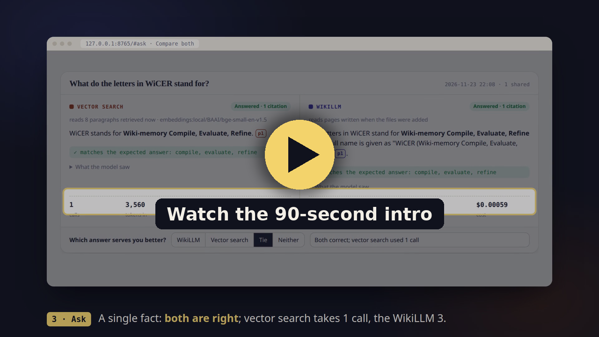

# ragwiki

**Vector search or a WikiLLM? Build either one from your own documents, and let your
questions decide.** ragwiki turns PDFs, Word, PowerPoint and text files into a vector search
index (RAG), a wiki that a language model writes and keeps linked (WikiLLM), or both, and
answers with the same model either way. Every claim links back to the paragraph it came
from.

[Leer en español](README.es.md)

## See it in 90 seconds

[](docs/video/media/ragwiki-intro-en.mp4)

The video follows a real run on five arXiv papers about LLM wikis, answered by `deepseek-flash`:

1. **Files.** Five PDFs become 184 citable paragraphs, for free.
2. **Build.** The vector index is built on the computer; the WikiLLM writes 24 linked pages for
   $0.11, with the cost shown before spending.
3. **Ask.** For a single fact both are right and vector search spends less. For a question that
   joins several papers only the WikiLLM brings them together, at about 11 times the cost.
4. **Results.** A recommendation for this corpus, with costs, times and the person's verdicts.

[Watch it in Spanish](docs/video/media/ragwiki-intro-es.mp4). The video is generated by code in
[`docs/video`](docs/video/README.md), so it can be updated when the lab changes.

> Status: early development, built in the open from a master's research project. See the
> [roadmap](#roadmap) for what works today.

## Quick start: the lab

```bash
git clone https://github.com/jdramirezzu/ragwiki.git && cd ragwiki
uv sync --extra lab
uv run ragwiki lab ~/my-lab
```

The page opens in your browser at `http://127.0.0.1:8765`. It runs on your computer only;
the model calls are the one thing that leaves it. Set the model in the page (the key is kept
in memory, never written to disk) or with the `RAGWIKI_*` variables below.

1. **Files.** Drop PDFs, Word or PowerPoint files, or plain text (`.txt`, `.md`). Adding is
   free: the text is extracted on your computer into citable paragraphs.
2. **Build.** Build the **vector search** index (embeddings on your computer, free; or your
   provider's), the **WikiLLM** (about two model calls per file, with the cost shown before
   you spend), or both. The page explains how they differ and when each one pays off.
3. **Ask.** Ask with the one you built, or with both: the same model answers twice and the
   answers appear side by side with citations, tokens, time and cost. Click a citation to
   read the source paragraph beside the answer. Optionally add the expected answer as key
   terms (`What produces ATP? | ATP, mitochondria`), or `none` when your files do not
   answer it.
4. **Results.** Judge each pair, download everything as CSV or JSONL, and read the
   recommendation: the WikiLLM is suggested only when it answers clearly better (a gap of
   at least 0.10 over five or more evaluated questions); otherwise vector search, which
   costs less.

| | Vector search (RAG) | WikiLLM |
|---|---|---|
| When the work happens | At every question | Once, when a file is added |
| Building | Free with local embeddings | About 2 model calls per file |
| Each question | 1 model call | Up to 8 model calls |
| Best at | Single facts; files that change often | Questions that join several documents |
| You also get | Nothing to read | A linked wiki you can browse in Obsidian |

## Command line

ragwiki is not on PyPI yet. Install it from a clone with [uv](https://docs.astral.sh/uv/):

```bash
git clone https://github.com/jdramirezzu/ragwiki.git && cd ragwiki
uv sync
```

1. Point ragwiki at a model. Any OpenAI-compatible endpoint works:

   ```bash
   export RAGWIKI_MODEL="<model-name>"
   export RAGWIKI_BASE_URL="<provider-url>"   # for a local Ollama: http://localhost:11434/v1
   export RAGWIKI_API_KEY="<your-key>"        # not needed for a local model
   ```

2. Create a vault and add your notes:

   ```bash
   uv run ragwiki init my-wiki
   cd my-wiki
   uv run ragwiki add ~/notes/biology.md
   uv run ragwiki status
   ```

3. Ask a question. The answer cites the paragraphs it comes from, and says so when your
   notes do not cover it:

   ```bash
   uv run ragwiki ask "What do mitochondria do?"
   ```

4. Open `my-wiki/` in Obsidian or any editor and read your pages.

No notes at hand? Follow the [walkthrough](docs/demo.md) with the example notes in
[`examples/`](examples/README.md).

| Optional variable | Meaning |
|---|---|
| `RAGWIKI_PRICE_INPUT`, `RAGWIKI_PRICE_OUTPUT` | Your provider's price in USD per million tokens, so costs are reported |
| `RAGWIKI_MAX_USD` | Spending cap for one command |
| `RAGWIKI_VAULT` | Vault folder, when you are not inside it |
| `RAGWIKI_VISION_MODEL` | Model used for photos, when the main one cannot see images |
| `RAGWIKI_VISION_BASE_URL`, `RAGWIKI_VISION_API_KEY` | Only when the vision model is at another provider |
| `RAGWIKI_CONTEXT_TOKENS` | Your model's context window in tokens (default 32000). Lower it for small local models |

Today ragwiki reads Markdown and text (`.md`, `.markdown`, `.txt`), PDF, Word (`.docx`),
PowerPoint (`.pptx`) and photos of notes (`.png`, `.jpg`, `.jpeg`, `.webp`). Spreadsheets are
left out on purpose: they hold data rather than notes.

A photo is transcribed by a model that can see images. The transcription is saved in
`extracted/` next to your original photo, so you can check it. If your text model cannot
see images, set `RAGWIKI_VISION_MODEL` to one that can. A PDF needs a text layer: for a
scan, add its pages as photos.

Before any model call, `add` prints an estimate of the calls, tokens and price. When the
price is above zero it asks you to confirm; `--yes` skips the question and `--estimate`
only shows the estimate. The estimate is rough: token counts are approximated from text
length, and the real cost of each call is recorded in `.ragwiki/calls.jsonl`.

A source larger than the model's context window is split into parts, and nothing is written
unless every part succeeds. Paragraphs are never cut, so citations stay exact.

## Why a wiki and not just search

Most "chat with your documents" tools search your files again for every question. ragwiki
instead writes knowledge down once, as pages that connect ideas across your sources, and
keeps those pages up to date as you add material.

This design comes from a [master's research project](https://github.com/1KVueltasAlCampo/llm-knowledge-management-wiki-agent) that compared both
approaches with the same model, the same 100 scientific papers and the same 100 questions:

| Finding | What ragwiki does about it |
|---|---|
| The wiki answered more questions correctly (0.70 vs 0.48 with 5 retrieved paragraphs), and its lead was largest when the answer joined several papers | The wiki is the core of the product |
| Each wiki question cost 7.2× and took 4.1× as long, plus a one-time cost to build the wiki. Giving RAG 20 paragraphs shrank the lead to +0.06, no longer significant | The [lab](#quick-start-the-lab) lets you check which one pays off for your files |
| The wiki kept what it learned but captured 63–80 % of what it could, and did not retire outdated values | Explicit abstention, citations verified by code, and a planned `lint` command |

Those numbers come from one experiment on arXiv papers. They motivated the design; they are
not a guarantee for your notes.

## How it works

```
my-wiki/
  sources/      your original files, never modified
  extracted/    each source as Markdown with numbered paragraphs
  wiki/         the pages the model writes, linked with [[wikilinks]]
  index.md      catalog of pages
  log.md        history of what was added
  SCHEMA.md     your conventions: page types, language, style
```

The folder is plain Markdown. Open it in [Obsidian](https://obsidian.md) or any editor: the
links and the graph work, and a citation takes you to the exact source paragraph.

## Principles

- **Your knowledge stays yours.** Plain files on your disk, under Git, with no lock-in.
- **Any model.** Works with any OpenAI-compatible endpoint, including local models.
- **Traceable.** A citation that does not resolve to a real paragraph is removed.
- **Honest.** When your notes do not answer a question, ragwiki says so.
- **Costs are visible.** Every model call records tokens, time and price, with a spending cap.

## Roadmap

| Milestone | Scope | Status |
|---|---|---|
| M0 | Repository, packaging, CI | Done |
| M1 | Vault, Markdown ingestion, questions with verified citations | Done |
| M2 | PDF, office files, photos of handwritten notes, long sources, cost estimate | Done |
| Lab | Build vector search or a WikiLLM from your files, ask with either, compare both and get a recommendation | Done |
| M3 | Source-text search fallback, `lint`, saving answers as pages | Planned |
| Later | Graphical interface, flashcards, shared wikis | Ideas welcome |

## Contributing

Contributions of any size are welcome. Start with [CONTRIBUTING.md](CONTRIBUTING.md).

The lab is the first graphical interface: a small FastAPI server (`server.py`) and a
page with no build step (`src/ragwiki/web/`). If you design or build interfaces, read
[Designing an interface for ragwiki](docs/interface.md).

## License

[MIT](LICENSE)
